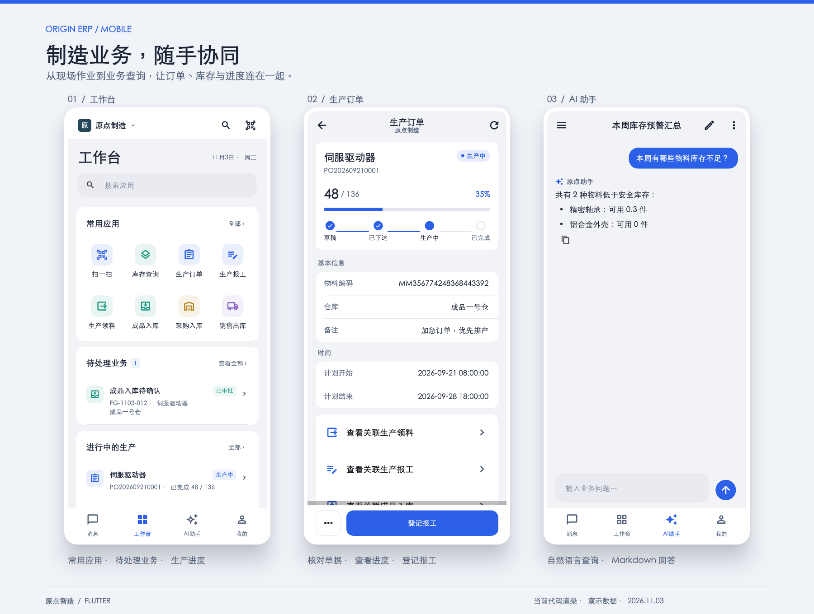
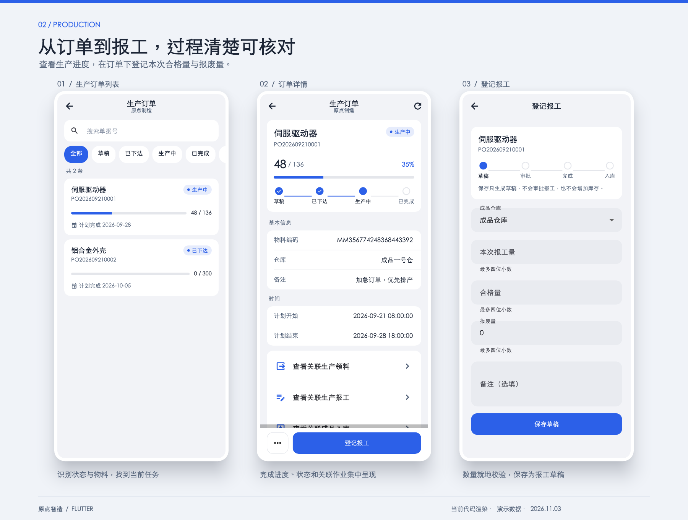
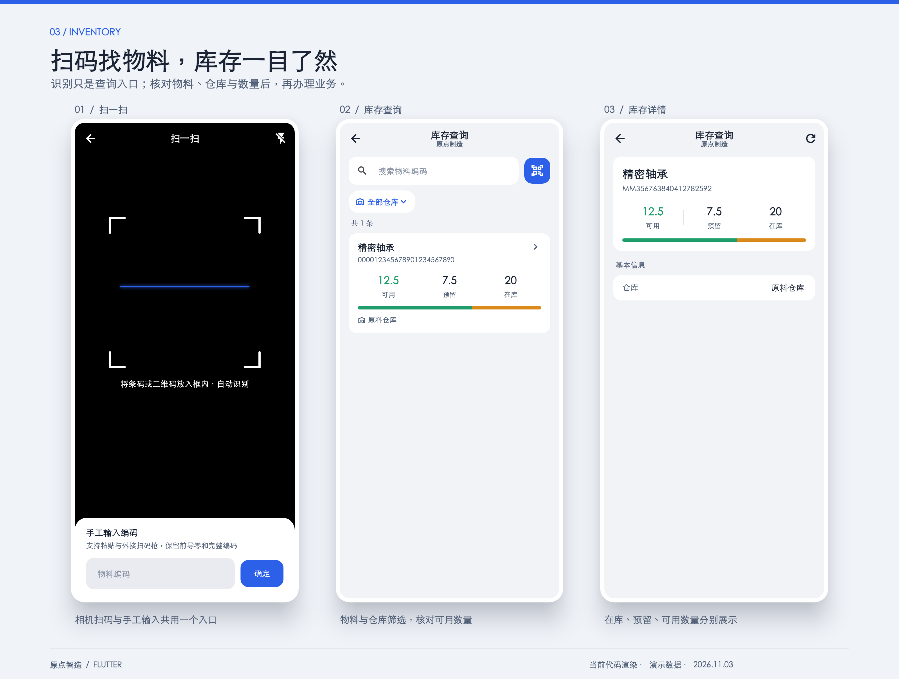
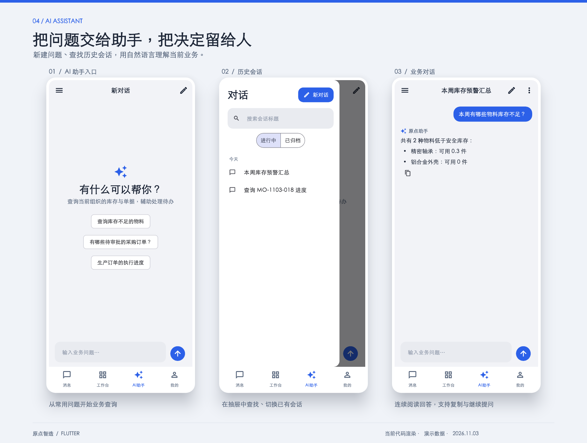
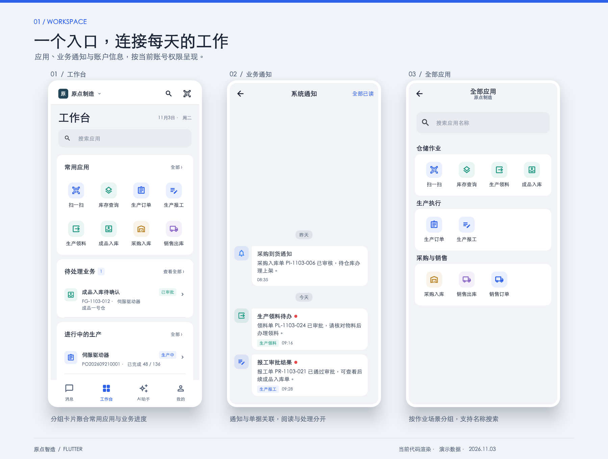
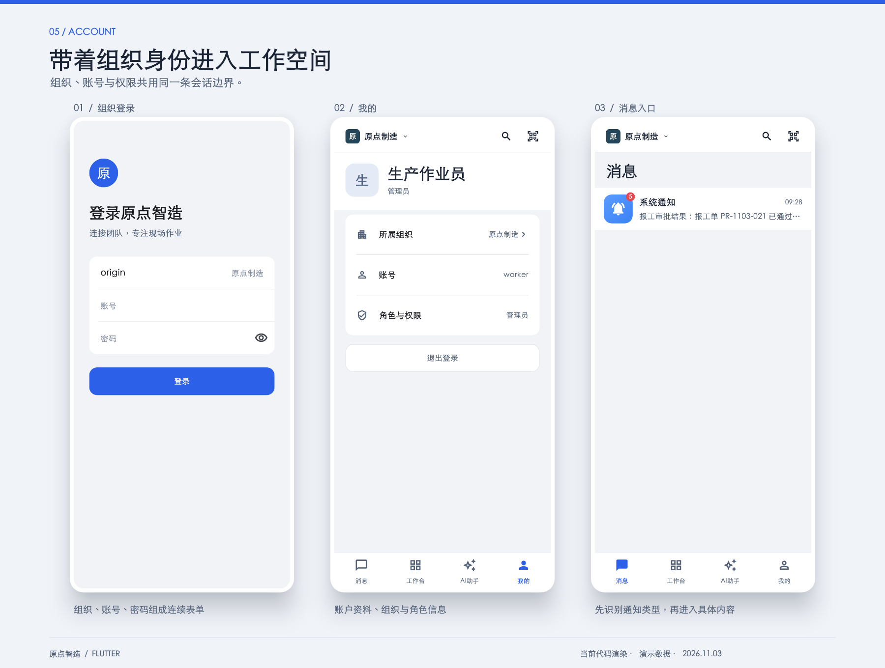

<div align="center">
  <h1>原点智造 · 移动端</h1>
  <p><strong>把车间、仓库和审批装进口袋的制造业务 App</strong></p>
  <p>扫码找料、领料报工、出入库、业务通知与 AI 助手，一部手机完成现场作业。</p>
  <p>
    <a href="#产品介绍">产品介绍</a> ·
    <a href="#功能一览">功能</a> ·
    <a href="#界面展示">界面展示</a> ·
    <a href="#技术栈与架构">技术栈</a> ·
    <a href="#快速开始">快速开始</a> ·
    <a href="#项目状态">项目状态</a>
  </p>
</div>



> 展示图由当前 Flutter 代码渲染，使用演示数据；用于展示现有界面，不代表生产环境数据或真机验收结果。

---

## 产品介绍

### 它解决什么问题

制造企业的计划、采购、仓库和产线分散在不同的人和地点。办公室里的订单、审批和库存数字，和现场的领料、报工、出入库之间，常常隔着纸单、微信群和事后补录。

**原点智造移动端**是 [ORIGIN ERP](https://github.com/weigu2700-cell/ORIGIN-ERP-BackEnd) 的手机 App（Android 与 iOS）。它直接使用 ERP 的账号、权限和单据，让现场人员在手机上完成该做的事，让办公室的进度在现场也看得见：

- **仓库人员**：查库存、扫码找物料、办理领料、成品入库、采购上架与销售出库
- **产线人员**：在生产订单下登记报工，查看进度与关联单据
- **审核与管理人员**：随时收到待办通知，在手机上核对并审批
- **所有人**：用自然语言向 AI 助手询问库存、订单与单据情况

### 适合谁

| 角色 | 在 App 里做什么 |
| --- | --- |
| 仓库管理员 | 库存查询与扫码；领料确认；成品入库、采购入库上架、销售出库 |
| 产线作业员 | 查看生产订单；按订单登记报工草稿 |
| 生产与采购审核人 | 接收业务通知；核对并审批领料、报工、入库 |
| 管理者 | 查看工作台待处理业务、订单进度、库存与销售情况；向 AI 助手提问 |

### 设计原则

- **先核对，再执行**：任何会改变库存或单据状态的动作，都会先回查最新状态，并在确认弹窗里写明影响，再提交；不会因为扫了码就自动过账。
- **权限即入口**：看不到的功能不显示；每个动作按精确权限码校验，服务端最终鉴权。
- **结果可追溯**：网络中断后若提交结果未知，App 会锁定并引导你回查单据，不会重复提交。
- **多组织安全**：切换组织即退出重新登录，旧组织的数据、请求和对话不会带到新组织。

---

## 功能一览

### 消息
类似即时通讯的会话列表，业务通知集中在「系统通知」会话里，按时间排列、按日期分隔。显示未读数，支持一键全部已读；点开通知可直接跳到对应的单据。

### 工作台
按你的权限展示常用应用（扫一扫、库存查询、生产订单、生产报工、生产领料、成品入库、采购入库、销售出库）、**待处理业务**和**进行中的生产**，顶部可直接切换组织与搜索应用。

### 扫一扫
全屏相机取景，自动识别条码与二维码；相机不可用时可手工输入、粘贴，或使用外接扫码枪。扫码只用来**查询与核对**，在领料页还能核对物料编码是否与单据一致。

### 库存查询
按物料编码搜索，按仓库筛选，分页浏览。每个物料用「可用 / 预留 / 在库」三个数字和一条占比条呈现，库存不足一眼可见。

### 生产闭环
```text
生产订单（下达 → 开工）→ 领料（审批 → 扫码核对 → 确认）→ 报工（草稿 → 审批 → 完成）→ 成品入库（审批 → 执行）
```
订单页显示完成进度和状态时间线，并链接到关联的领料、报工和成品入库单。报工完成会生成入库单，**只有入库执行才会增加库存**。

### 采购与销售
采购入库：审核与上架（选择仓库、库位、批次）。销售出库：确认、执行、取消，并可查询销售订单。

### AI 助手
默认进入全新的对话，左侧抽屉管理历史会话（搜索、进行中、已归档）。支持流式回答、随时停止、复制、归档。当助手提出可执行的业务动作（如审批采购订单）时，必须由你核对并确认，且会重新校验权限。

### 我的
账号、角色、所属组织，以及切换组织与退出登录。

---

## 界面展示

### 生产执行

从订单列表查看状态与进度，进入详情核对物料、时间和关联作业，再登记报工草稿。



### 库存与扫码

扫码或手工输入物料编码，按仓库查询库存，分别核对在库、预留和可用数量。



### AI 业务助手

从常用问题开始查询，在历史会话抽屉中切换对话，连续阅读业务回答。



<details>
<summary>展开查看工作空间、消息与应用目录</summary>



</details>

<details>
<summary>展开查看组织登录、我的与消息入口</summary>



</details>

[查看全部展板、单页高清图与生成方法](docs/design/flutter-current/README.md)。

---

## 技术栈与架构

### 移动端（本仓库）

| 层面 | 选型 |
| --- | --- |
| 框架 | Flutter 3.47 / Dart 3.13，一套代码覆盖 Android 与 iOS（同时可在 macOS 上调试） |
| 路由 | go_router：底部四个主入口各有独立导航栈，切换时保留各自页面状态 |
| 网络 | dio：统一的响应包裹解析、401 处理、请求取消；SSE 流式读取 AI 回答（含 UTF-8 分片、断流恢复） |
| 安全存储 | flutter_secure_storage：JWT 按服务器地址隔离，不保存密码 |
| 扫码 | mobile_scanner：相机取景与条码识别 |
| 内容渲染 | flutter_markdown_plus：AI 回答的 Markdown |
| 界面 | Material 3 为基础，按 iOS 设计语言定制：分组圆角卡片、大标题、侧滑返回、iOS 悬浮毛玻璃底栏并避让灵动岛 |

### 服务端（另一仓库）

Java 21、Spring Boot 4、MyBatis-Plus、MySQL、Redis、Flyway、WebSocket，AI 能力基于 Spring AI。移动端只通过 REST 与 SSE 访问，不直连数据库，不保管模型密钥。

### 代码结构

```text
flutter/lib/
  core/       API 客户端、请求取消、会话与安全存储
  domain/     单据定义、权限与状态、数量精度、仓库规则
  features/   登录、消息、工作台、库存与单据、报工、扫码、AI 助手
  ui/         主题与设计 token、通用卡片、状态与确认组件
flutter/test/ 契约、身份隔离、页面与布局测试
flutter/tool/ 运行脚本、平台配置、预览与联调自检
docs/         设计稿与业务需求、权限补齐 SQL
```

分层为「页面 → Repository → API 客户端」：页面只管展示与局部状态，业务规则（状态流转、权限码、数量精度）放在 `domain/`，网络与会话放在 `core/`。

### 关键工程约定

- **身份边界**：组织或用户变化时替换整个导航栈，取消进行中的 HTTP 与 AI 流，并忽略迟到的响应。
- **数据精度**：ID 一律使用字符串，避免大整数丢精度；数量用字符串提交，以整数万分位比较，最多四位小数；服务端可能以字符串返回 Long（如分页总数），统一用 `asInt` 解析。
- **写操作**：执行前回查最新状态并明确确认；结果未知时锁定并引导回查，不自动重放。
- **AI**：沿用服务端 `CONTENT / TITLE / ACTION / ERROR` 事件；新对话在首次发送时才创建。

---

## 快速开始

### 准备

- Flutter 3.47（版本见 `flutter/.flutter-version`）
- Android 需要 Android SDK；iOS 与 macOS 需要完整 Xcode
- 一个已启动的 ORIGIN ERP 后端

### 运行

```bash
cd flutter
./tool/flutterw run --dart-define=API_BASE_URL=http://localhost:8080
```

`API_BASE_URL` 是后端地址，**不带 `/api` 前缀**，在编译时写入，修改后需重新启动（热重载不生效）。

| 运行环境 | 地址 |
| --- | --- |
| iOS 模拟器 / macOS | `http://localhost:8080` |
| Android 模拟器 | `http://10.0.2.2:8080` |
| 真机 | `http://<电脑局域网 IP>:8080`，手机与电脑在同一网络 |

未配置地址时，登录页会提示配置错误，不会连接任何演示服务器。Debug 构建允许明文 HTTP，生产环境必须使用 HTTPS。

`tool/flutterw` 会依次查找 `FLUTTER_ROOT`、工作区 `.tooling/flutter` 和 PATH 中的 `flutter`；Pub 缓存默认使用国内镜像，可通过 `PUB_HOSTED_URL`、`FLUTTER_STORAGE_BASE_URL` 覆盖。

### 开发与测试

```bash
cd flutter
./tool/flutterw --format-dart lib test tool   # 格式化
./tool/flutterw analyze                       # 静态分析
./tool/flutterw test                          # 契约、身份隔离、页面与布局测试
./tool/flutterw test tool/preview_test.dart   # 渲染各页面截图到 output/preview/
PREVIEW_IOS=1 ./tool/flutterw test tool/preview_test.dart   # 模拟灵动岛安全区
```

对真实后端做只读契约自检（需要后端已启动，账号自备）：

```bash
LIVE_URL=http://localhost:8080 LIVE_USER=<账号> LIVE_PASS=<密码> ./tool/flutterw test tool/live_check.dart
```

构建示例：

```bash
./tool/flutterw build apk --debug --target-platform android-arm64 --dart-define=API_BASE_URL=http://10.0.2.2:8080
./tool/flutterw build macos --debug --dart-define=API_BASE_URL=http://localhost:8080
```

### 后端依赖

使用的主要接口（均无 `/api` 前缀）：`/auth/*`（组织解析、登录、会话）、`/system/user/current`、`/system/permission`、`/master/warehouse`、`/inventory/material-stock`、`/prd/order`、`/prd/picking`、`/prd/report`、`/inv/finish-warehousing`、`/purchase/in/stock`、`/sales/delivery`、`/sales/order`、`/sys/notification`、`/ai/*`。

部分开发库缺少领料、报工、成品入库的细分权限码，会导致这三项返回 403。可用 [docs/sql/mobile-permissions.sql](docs/sql/mobile-permissions.sql) 补齐并授予 `admin` 角色（可重复执行，执行前请先核对数据库）。

---

## 项目状态

**当前为首个可运行版本，尚不能直接用于生产。**

- ✅ 已验证：静态分析无错误；22 项自动化测试（契约、身份隔离、页面与窄屏大字体布局）；对真实后端的只读联调（登录、库存、生产订单、销售、通知、AI 会话列表）；Android ARM64 与 macOS 调试包可构建。
- ⏳ 尚未验证：所有写操作的真实联调；Android / iOS 真机的相机、扫码枪、返回手势、键盘与 200% 字体；iOS 构建与毛玻璃实际效果；弱网与后台恢复；发布签名与分发。
- 🚧 已知缺口：厂商 PDA 扫描头未适配；通知通过刷新获取，未接 WebSocket；AI 回答的 Markdown 表格与业务链接未做；报工与 AI 创建请求的幂等需要后端支持；多语言、最近组织记录、通知设置与离线制单暂不支持。
- 包标识 `cn.origin.origin_mobile` 仅为本地开发标识，生产标识、签名与分发方式待定。

财务核算、薪资、人力资源和对外商城不在产品范围内。
